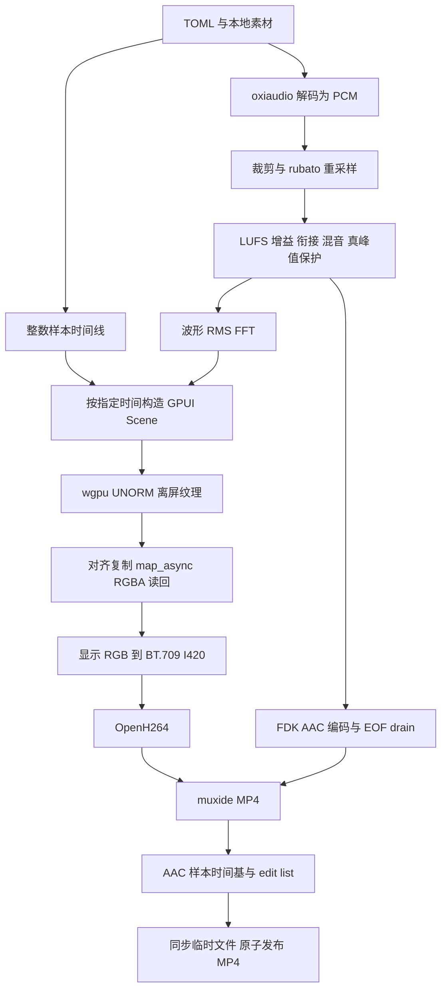

# Audorchid 实现计划

更新：2026-10-03。项目自有代码采用 Apache-2.0，根目录提供 LICENSE 与 NOTICE。源码研究证据保留在[阅读记录](source-review.md)和[固定版本清单](research/source-manifest.json)；实现与实测状态以本文件和[验收记录](validation.md)为准。

## 产品与配置

音兰是离线音乐展示视频生成器，以 TOML 决定曲目、素材、衔接和输出。音乐播放器是视觉表现；没有声卡播放时钟，没有播放、暂停或切歌按钮。歌曲切换由成片样本时间线驱动。

提供四个内置固定版式：16:9、9:16、1:1、3:4。每种版式固定封面、文字、波形、时间与进度的位置和字号；其它相同比例分辨率整体等比缩放。自定义布局必须显式选择 custom 并提供全部矩形和字号。具体坐标见[配置文档](configuration.md)。

提供[中文 TOML](../examples/audorchid.zh-CN.toml)和[英文 TOML](../examples/audorchid.en.toml)。两份数据相同，注释覆盖单位、可选值、默认行为、路径基准以及可直接运行的演示命令。schema 1 对未知字段报错。未实现的选项不出现在示例中。

新增中英文简洁版：仅 tracks.audio 必填，标题取文件名、字体内置、输出默认 audorchid.mp4。仅选比例即可推导标准尺寸。默认自动编排、逐曲 −16 LUFS，可明确 configuration/off 保持顺序/原响度；详见[默认值设计](defaults.md)。

用户认可的间距与浅黄色实际交叠提示保留：进度与作者左对齐并稍向下，本轮改白色、封面圆角 24。频谱目标柱宽 14.5，按区域宽自适应 80/40/43/43 根，明确 bars 仍固定数量。preview 默认第 0 帧，也可指定时刻；preview/render 支持临时路径、等比缩小、显式覆盖，不改 TOML。

## 数据流与模块

| crate | 当前职责 |
| --- | --- |
| audorchid-core | 严格 TOML 解析、素材路径、固定/自定义布局、样本时间线 |
| audorchid-audio | oxiaudio 解码、rubato 重采样、可调曲线混音、RMS/波形/FFT、AAC |
| audorchid-render | 字形检查、GPUI 视图、字体/封面缓存、确定性画面、wgpu 读回 |
| audorchid-export | CLI、BT.709 转换、OpenH264、muxide、AAC edit list、演示素材 |

## 时间与声音

所有内部 sample 指每声道样本帧，双声道对应两个交错 f32。源裁剪先转换为源样本；重采样后的样本数用整数比率向上取整，消除浮点 ceil 多出一个样本的情况。相邻曲目起点为 start[i+1] = start[i] + length[i] - overlaps[i]；固定模式的 overlaps 各项相同，adaptive/smart 各次独立。禁止三首同时交叠。

第 k 帧对应 floor(k × sample_rate × fps_den / fps_num)；总帧数为 ceil(total_samples × fps_num / (sample_rate × fps_den))。不用反复浮点累加推进时间。OpenH264 的毫秒接口和 MP4 的时间戳分别由同一个帧号计算。

衔接默认 smart：首尾扫描检测低能量尾部/前奏，排除它们后测局部 LUFS，搜索提前混入时间，渲染有界平滑增益、温和频段交接和立体声扩散。fixed 保留 2 秒等功率曲线和 smooth/linear/shape 覆盖，adaptive 保留仅长度搜索。0 秒禁用所有衔接。音频/图片/章节/进度共用实际交叠时间线，无三曲重叠，不自动删素材/变速/对拍。ebur128 仍测完整 LUFS 与真峰值，混音后优先保证真峰值；可视化与 AAC 使用同一最终 PCM。

FDK wrapper 在 vendor/fdk-aac 内有最小补丁：bufSizes 按字节填写，公开 numInSamples=-1 的 EOF drain。记录 nDelay、有效长度、尾部 padding。MP4 写完后将 AAC 时间基改为采样率，stts 固定为真实 AAC 帧长度，写入精确样本时长的 edit list。未随意删除压缩帧。

## 渲染与色彩

GPUI 相关 crate 固定同一 Git revision。HeadlessAppContext 接入真实 CosmicTextSystem 和自定义 PlatformHeadlessRenderer，无原生窗口。GPUI 测试平台有 2 倍 DPI，因此布局转换为逻辑像素、输出保持配置设备像素；不将屏幕 DPI 带入成片。

离屏代码以 GPUI 的 offscreen_renderer 为基础保留 Apache 许可和修改说明，目标纹理使用 Rgba8Unorm。当前 GPUI atlas/UI shader 使用显示编码色值，Rgba8UnormSrgb 会重复编码而使画面发白。导出层保留已经用于显示的 R′G′B′ 数值，直接进行 BT.709 矩阵与 limited-range I420 转换；不再额外转换亮度曲线，避免 PNG/视频中间调不一致。

三角形由 seed、粒子 ID 和绝对成片时间直接求值；RMS 平滑从音频样本窗口计算，不逐帧积累随机状态。波形保存 10 ms 左右声道峰值，按可见区域保留峰值降采样。FFT 使用 4096 点因果 Hann 窗、8～256 个可配对数频段，分别测量左右声道；100 Hz 音频分析时钟控制回落/峰值保持，任意顺序取帧结果一致。静音时隐藏频谱和波形。示波器显示带正负号的左右声道 PCM，包络模式保留前后各 6 秒。

Roboto 仅负责非 CJK 文字/数字，Dream Han 负责 CJK。启用 tnum、lnum，关闭 pnum；文字根据实际塑形宽度换行和截断。字体 family 优先读取 OpenType name 16，兼容 Dream Han 的 typographic family 与旧式 W10 family 差异。

编码明确关闭跳帧并设置码率、帧率、关键帧间隔和 VUI。每次编码输出作为一个 access unit；为空则报错。每帧完成布局、绘制与读回后再推进时间，GPU 缓冲扩容只重试同一帧。

## 已落地的首版范围

- check / inspect / preview（兼容 frame）/ render / demo 命令；首帧 PNG、指定时刻、临时路径、缩小预览/视频、覆盖参数。
- 四种固定版式及完整自定义坐标；PNG/JPEG 封面、真实中英文字体。
- 裁剪、重采样、单双声道输入、双声道输出、交叉淡化、峰值衰减。
- 自动切歌、封面过渡、默认逐曲进度（可选整段）、黄色真实交叠区间、右端对齐计数、示波线/包络波形、可改色/疏密的白色宽柱频谱；三角形默认关闭，可选实心叠层和可调厚度边框预设。
- 紧凑的单行标题与作者；默认作者下方小进度条，可视化支持底部/作者下方、进度贴合和尺寸缩放。
- H.264 + AAC-LC + MP4；AAC 延迟和尾帧；失败清理临时文件，默认拒绝覆盖。
- 可重复生成的两首原创 16 秒演示短曲：MIDI 事件驱动自制合成采样，同时输出 WAV/MIDI；不使用第三方音乐或采样。

## 后续实施顺序

1. 长视频：流式解码/磁盘 PCM 缓存、分析缓存、增量 MP4，替换普通 muxide 全包驻留内存。现阶段不宣称支持任意长度。
2. 性能：测量读回、颜色转换、编码各阶段耗时；验证有界 readback 队列与背压，在保持帧序和确定性的前提下并行。
3. 输入回归：更多 MP3/M4A/FLAC 编码器的 gapless metadata、损坏文件、多种采样率与罕见字符；不以“解码成功”代替长度正确。
   已实现首尾 15 秒分析、按能量曲线和首尾特征自动重排，亦可严格保留 TOML 顺序。另有可选端点能量搜索来逐次选择交叠长度；仍保留全部素材，没有静音裁剪、节拍/乐句匹配或 DJ 切点推荐，见[衔接设计](transitions.md)。
4. 歌词：先逐行 LRC，再逐字歌词；跟随各曲目的源时间映射，保持四种固定版式的阅读区域。
5. Linux/macOS 实测与发行物许可证收集，随后考虑桌面预览与硬件编码。

“快速”依据实测 fps 和峰值内存说明，不提前承诺实时导出。原生 codec 专利与发行责任不由项目 Apache-2.0 自动覆盖。
